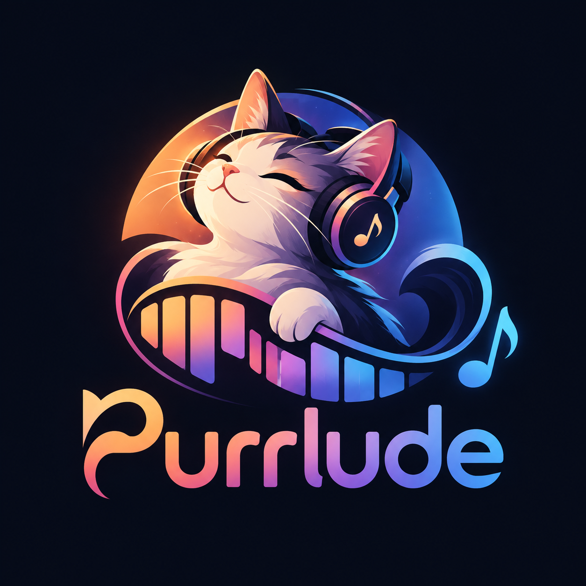

<p align="center"></p>

# Purrlude

Purrlude is a cross-platform music workstation for writing, recording, arranging and mixing songs, and for seeing them as sheet music as you go. It aims to be easy for beginners and deep enough for power users.


> **Status: beta on macOS, alpha on Windows and Linux.** The main features work and are in daily use on macOS (Apple Silicon). There are no prebuilt downloads yet: build from source (below). Windows and Linux build and pass the tests in CI but haven't seen real use. Project files may still change format before 1.0.

## What it does

- **Sheet music from your song.** Every track becomes a part in a live score that follows playback. It includes chord symbols, drum notation and transposing instruments, and exports to PDF (full score or parts) and MusicXML.
- **Audio to MIDI.** It turns a recorded melody, chords or drums into notes, and can separate a mixed song into drums, bass, vocals, guitar, piano and the rest. Everything runs on your computer; no audio is sent anywhere.
- **Recording.** It records MIDI and audio, with count-in, metronome, and loop recording into takes.
- **Arranging and editing.** Clips can be moved, copied and resized, and there's a piano roll. Every edit can be undone, and projects autosave with crash recovery.
- **Built-in sounds and plugins.** It has the 128 General MIDI instruments, drum loops in 14 styles, and bass and chord accompaniment in any key. It also loads third-party instruments and effects (VST3, Audio Units, LV2).
- **Mixing.** Each track has volume, pan, mute and solo, plus reverb, delay, EQ and a compressor, and there's a shared reverb. Volume, pan, the reverb send, every effect control and any plugin control can be automated. Export as WAV, FLAC or Ogg, or as stems.
- **Devices.** It works with any audio interface and any USB or Bluetooth MIDI keyboard. It can play a keyboard's own sounds, and play songs through multi-timbral sound modules and software synths.

The **[user guide](docs/user-guide/README.md)** covers all of it, with screenshots.

## Road to 1.0

- **Releases:** a signed, notarised macOS app to download, then Windows and Linux installers.
- **Instrument separation for everyone:** host the Demucs model so builds can fetch it.
- **Testing:** real use on Windows and Linux, and beta testers on other machines and devices.
- **Missing DAW features:** time-signature changes within a song.
- **A stable project format** from 1.0 on, so songs saved then keep opening.

## Building

Purrlude is C++20 on [JUCE](https://juce.com) 8 and [Tracktion Engine](https://github.com/Tracktion/tracktion_engine) 3.2. You need CMake 3.22 or later and a C++20 compiler (Xcode or Clang on macOS, Visual Studio 2022 on Windows, GCC or Clang on Linux). Dependencies are downloaded on first configure into `.cpm-cache/`, which is slow the first time.

```sh
# macOS, Linux, or any platform with Ninja
cmake --preset ninja
cmake --build --preset ninja-debug
ctest --preset ninja-debug

# Windows (Visual Studio 2022)
cmake --preset vs2022
cmake --build --preset vs2022-debug
ctest --preset vs2022-debug
```

On Linux, install JUCE's system packages first:

```sh
sudo apt-get install ninja-build libasound2-dev libjack-jackd2-dev ladspa-sdk libcurl4-openssl-dev \
  libfreetype-dev libfontconfig1-dev libx11-dev libxcomposite-dev libxcursor-dev libxext-dev \
  libxinerama-dev libxrandr-dev libxrender-dev libwebkit2gtk-4.1-dev libglu1-mesa-dev mesa-common-dev
```

**Separating instruments** needs the Demucs model (`htdemucs_6s.onnx`, 115 MB), which isn't downloaded automatically yet. `tools/models/export_demucs.py` makes it from Meta's published weights; see the script for details. Everything else works without it.

## Licence

Purrlude is free software under the **GNU Affero General Public License v3.0**; see [LICENSE](LICENSE). It's built on JUCE (AGPLv3) and Tracktion Engine (GPLv3).

It also uses:
- **[Verovio](https://www.verovio.org)** (LGPLv3) for score engraving
- **[ONNX Runtime](https://onnxruntime.ai)** (MIT), with telemetry switched off
- Spotify's **[basic-pitch](https://github.com/spotify/basic-pitch)** model (Apache 2.0)
- Meta's **[Demucs](https://github.com/facebookresearch/demucs)** (MIT)
- **[TinySoundFont](https://github.com/schellingb/TinySoundFont)** (MIT) with the **GeneralUser GS** SoundFont
- drum loops from Google Magenta's **[Groove MIDI Dataset](https://magenta.tensorflow.org/datasets/groove)** (CC BY 4.0)

[content/LICENSES.md](content/LICENSES.md) lists every bundled asset with its source, author and licence.
