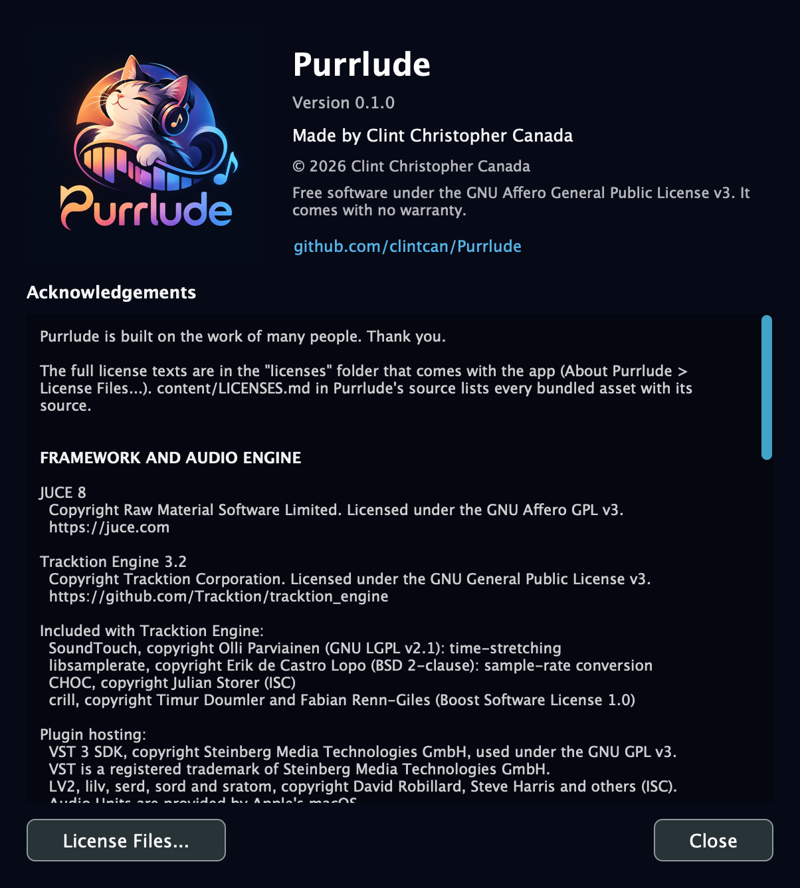

# 1. Getting Started

[← Contents](README.md) · [Next: Projects →](02-projects.md)

## Starting Purrlude

While Purrlude starts, its splash screen shows the logo and version. It goes once the window is ready; click it to close it sooner.

**About Purrlude** shows the version, who made Purrlude, its license, and the acknowledgements: the libraries, fonts, sounds and models it's built on, with their authors and licenses. Open it from the **Purrlude** menu on macOS, or **Help** on Windows and Linux. **License Files...** shows the full license texts that come with the app.

 

## The window

The window has four areas:

- **The toolbar** at the top. On the left are the [transport controls](03-transport.md): return to start, Play, Record, Loop, the position, tempo and time signature, and the Metronome and Count-in switches. On the right are five buttons:
  - **Editors** shows or hides the Score and Piano Roll below the arrangement.
  - **Audio** chooses your audio interface ([Devices](13-devices.md)).
  - **Plugins** finds the third-party instruments and effects on your computer ([Plugins](10-effects.md#plugins)).
  - **Loops** opens the [Loops & Accompaniment](09-loops-and-accompaniment.md) panel.
  - **MIDI Devices** opens the [MIDI and Bluetooth devices](13-devices.md) panel.
  
  Only one side panel shows at a time; click its button again to close it.
- **The arrangement**, where your song is laid out: one lane per track, each with a header of controls on the left and its clips on the right. The ruler above it shows bar numbers. See [Tracks](04-tracks.md) and [Arranging Clips](05-arrangement.md).
- **The editors** below it: the **Score** tab shows the whole song as [sheet music](08-score.md), and the **Piano Roll** tab edits one clip's [notes](07-piano-roll.md). **Full Height**, at the right of their tabs, gives them the whole window.
- **A side panel** on the right, when one is open.

Purrlude starts with an empty song with one instrument track, and the MIDI Devices panel open. Songs you've worked on are under **File > Open Recent**.

## A first song in a few minutes

1. **Connect a keyboard** (optional). Any USB or Bluetooth MIDI keyboard plays the selected track straight away; see [Devices](13-devices.md). Without one, you can still add notes in the [Piano Roll](07-piano-roll.md).
2. **Pick a sound.** In the first track's header, open the instrument menu (it says *Acoustic Grand Piano*) and choose any of the 128 General MIDI sounds.
3. **Add drums.** Click **Loops**, choose a style (Rock, Pop, Funk, ...), and double-click a loop. It goes on a new *Drums* track at the playhead, and an empty song takes the loop's tempo.
4. **Add bass and chords.** In the same panel, click **Bass**, pick a pattern and double-click it. Do the same under **Chords**. Both follow the song's key and the chord progression you pick.
5. **Record.** Click the first track's header to select it (its **Arm** button lights up), press **R** and play. With **Count-in** on you get one bar of clicks first. Press **R** or **Space** to stop.
6. **See it as sheet music.** The **Score** tab updates as you work. **Cmd+E** saves it as a PDF.
7. **Save.** Press **Cmd+S**. Projects go to `Documents/Purrlude` unless you choose somewhere else.

To undo any step, press **Cmd+Z**. Every edit can be undone.
