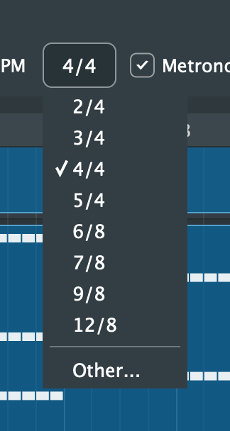

# 3. Transport, Tempo and Looping

[← Projects](02-projects.md) · [Contents](README.md) · [Next: Tracks and Mixing →](04-tracks.md)

## Playing

| Control | Key | What it does |
|---|---|---|
| **\|<** | Home | Moves the playhead back to the start |
| **Play** / **Stop** | Space | Starts and stops playback |
| **Record** / **Stop Rec** | R | Records onto the armed tracks; see [Recording](06-recording.md) |
| **Loop** | L | Repeats the loop range; see below |

**Where playback starts:**
- It starts from the playhead, the yellow line.
- To move the playhead, click a bar number on the ruler, or click an empty part of a track's lane.
- Pressing Play at or past the end of the song starts from the beginning.
- Playback stops by itself a second after the last clip ends (not while looping or recording).

The position display shows the playhead as **bar.beat** and as **minutes:seconds**. For example, `3.3   0:06` is the third beat of bar 3, six seconds in.

## Tempo

The tempo is the number before **BPM**. Click it, type a new value between 20 and 400, and press Return.
- Notes stay on their beats, so the whole song speeds up or slows down.
- Importing a MIDI file or adding a drum loop to an empty song sets the tempo for you.

A song has one tempo. Tempo changes partway through aren't supported yet.

## Time signature

Click the time signature (it says **4/4**) and choose another, or **Other...** for any other.
- The **Other...** dialog asks how many beats are in a bar (1–32) and which note gets the beat (2, 4, 8 or 16).
- **Changing it keeps the music where it is**: notes don't move, only the bar lines do. For example, a song in 4/4 changed to 3/4 sounds the same, barred in threes.
- The change is one undo step.

**Limits:**
- A song has one time signature.
- The built-in drum loops and accompaniment are written in 4/4.
- The time signature can't be changed while recording.

 

## Metronome and count-in

- **Metronome** clicks on every beat while playing and recording. It's never included in exported audio.
- **Count-in** plays one bar of clicks before recording starts.

## Loop playback

The thin strip along the top of the ruler holds the **loop range**, shown as a band. While looping is on, the band is orange and the lanes under it are shaded. While it's off, the band is grey.

**Setting the loop:**
- Turn looping on and off with the **Loop** button or **L**.
  - Turning it on with no range set loops four bars from the playhead's bar.
- Drag along the top strip to set a new range. It snaps to bars; hold **Shift** to snap to beats.
- Drag the band to move it, or drag either end to change its length.
- Click the band to turn looping on or off.
- Right-click a clip and choose **Loop This Clip** to loop exactly that clip.

**While looping:**
- Playback repeats the range until you stop it.
- **Play** from outside the range starts at the range's start.
- Recording while looping records a new take on each pass; see [Recording](06-recording.md#loop-recording-and-takes).
- The range can't be changed while recording.

The loop range is saved with the song. It's measured in beats, so it stays on the same bars when the tempo changes.
