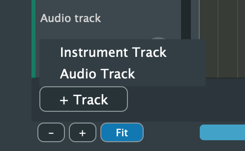
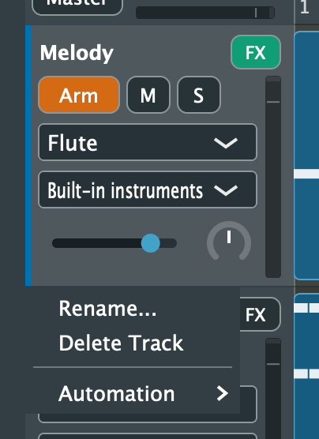
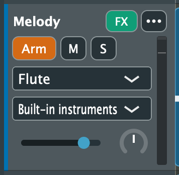
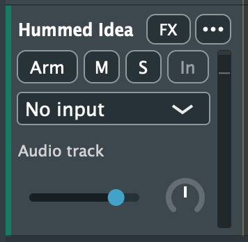
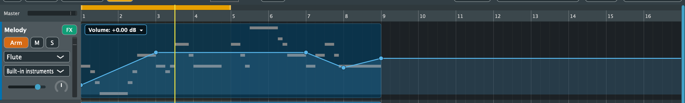

# 4. Tracks and Mixing

[← Transport](03-transport.md) · [Contents](README.md) · [Next: Arranging Clips →](05-arrangement.md)

A song is made of tracks, shown top to bottom in the arrangement. There are two kinds:

- **Instrument tracks** hold MIDI clips (notes) and play them with a sound: one of Purrlude's built-in General MIDI instruments, or a MIDI keyboard's own sounds.
- **Audio tracks** hold recordings and audio files. They have a **green stripe** on the left of their header.

## Adding, renaming and deleting tracks

- **Add a track:** click **+ Track** below the last track and choose **Instrument Track** or **Audio Track**.
- **Rename a track:** double-click its name, or right-click the header and choose **Rename...**.
- **Delete a track:** right-click the header and choose **Delete Track**. A song always keeps at least one instrument track, so the last one can't be deleted.

Tracks are also added for you when you add loops, import files or convert audio to MIDI.

 

## The instrument track header

**Top row:**
- **Name.** Double-click it to rename the track.
- **FX** opens the track's [effects](10-effects.md). It's lit green when the track has effects or a reverb send.

**Arm, mute and solo:**
- **Arm** (orange when on) makes this the track your keyboard plays and records onto. Clicking anywhere on an instrument track's header or lane also selects it, and the selected track is the armed one. A blue stripe marks it.
- **M** mutes the track.
- **S** solos it: when any track is soloed, only soloed tracks are heard.

**The two menus:**
- **The instrument menu** (here *Flute*) chooses the sound.
  - With built-in sounds, it lists the 128 General MIDI instruments by family (Piano, Organ, Guitar, Bass, Strings, Brass, Reed, Synth Lead, ...) and **Standard Drum Kit** under Drums.
  - When the track plays an external keyboard, it lists that keyboard's tones instead; see [Devices](13-devices.md#playing-a-keyboards-own-sounds).
- **The sound menu** (here *Built-in instruments*) chooses where the track is heard: Purrlude's built-in instruments, or a connected MIDI device's own sounds.

**Bottom row:**
- **The slider** is the track's volume, from silent to +6 dB. Double-click it to reset to 0 dB.
- **The knob** is the pan, left to right. Double-click it to centre.
- **The level meter** on the right edge goes green, then yellow above −6 dB, and lights vermillion at the top if the track went over 0 dB. Click it to clear the light.

 

## The audio track header

Audio tracks have the same name, FX, M, S, volume, pan and meter as instrument tracks. In place of the instrument and sound menus they have:

- **The input menu** chooses what the track records: an input of your audio interface or microphone. Each input can feed one track. See [Recording audio](06-recording.md#recording-audio).
- **Arm** arms the track to record its input. Arming a track with no input picks the first free one.
- **In** (input monitoring) lets you hear the input while the track is armed. It's off by default and can only be turned on once an input is chosen. Use headphones with a microphone, or the speakers will feed back into it.

A MIDI keyboard never plays an audio track: clicking one leaves the keyboard on the instrument track it was playing.

 

## Mixing

Every track's volume, pan, mute and solo are saved with the song and can be undone; a whole fader drag is one undo step. The **Master** meter at the left end of the ruler shows the level of the whole mix, with the same over-0 dB light as the track meters.

For reverb, echo, tone and dynamics, see [Effects and Reverb](10-effects.md).

## Automation

Automation makes a setting change over time: a fade-in, a louder chorus, a pan from left to right, or more echo at the end.

**Choosing what to automate:**
1. Right-click the track's header and open **Automation**.
2. Choose what to automate:
   - **Volume** or **Pan**
   - **Reverb send**, if the track sends to the shared reverb
   - any control of the track's effects, such as **Delay Mix** or **EQ Low**
3. The setting's line appears over the track's lane, with the clips dimmed beneath it. A dot (•) in the menu marks settings that already have automation.

**Drawing it:**
- **Add a point:** click in the lane. Drag as you click to place it.
- **Move a point:** drag it. It stays between its neighbours. Hold **Shift** to snap it to beats.
- **Remove a point:** double-click it, or right-click it and choose **Delete Point**.
- **Remove all of it:** right-click the lane and choose **Clear … Automation**. The setting goes back to its own value.
- **Show another setting, or none:** click the label at the top left of the lane (it shows the setting and its value at the playhead), or right-click the lane and choose **Hide Automation**. Hiding the line doesn't remove it: the setting keeps following it.

**How it plays:**
- Between points the setting changes in a straight line. Before the first point and after the last, it holds that point's value.
- Automation is heard in playback and in exported audio.
- An automated control follows its line and can't be moved by hand; its tooltip says why. Clear the automation to set it by hand again.
- Points stay on their beats when you change the tempo.
- Every change can be undone, and a whole drag is one step.

**Limits:**
- **No recording:** moving a control during playback doesn't record automation yet; draw it instead.
- **Tracks playing a keyboard's own sounds** can't be automated, as with effects.
- **Clips:** moving a clip doesn't move the automation over it.

**External sounds:** when a track plays a MIDI keyboard's own sounds, its volume and pan are sent to the keyboard (as MIDI CC 7 and 10). Its meter stays empty and effects aren't available, since the sound is made by the keyboard.
