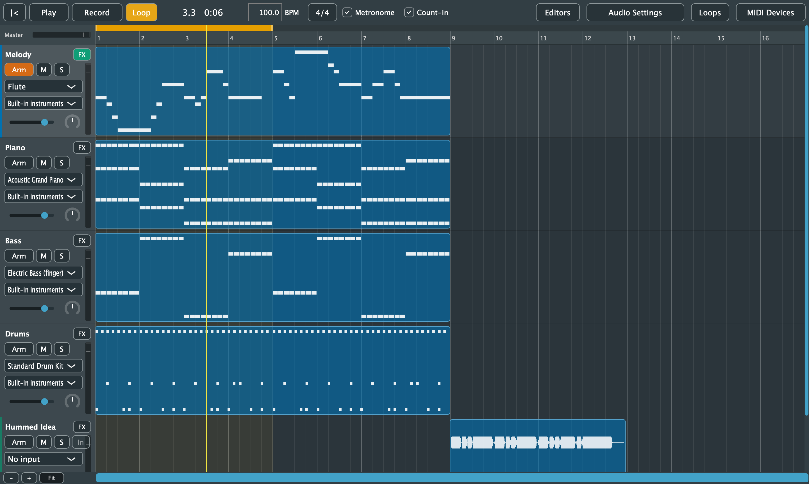
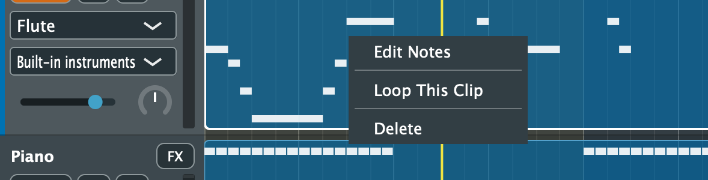

# 5. Arranging Clips

[← Tracks and Mixing](04-tracks.md) · [Contents](README.md) · [Next: Recording →](06-recording.md)

The arrangement shows the song from left to right, with bar numbers on the ruler. Each track's clips sit in its lane:
- **MIDI clips** show their notes.
- **Audio clips** show their waveform.

A clip whose audio file can't be found says **Missing:** and the file's name.

## Where clips come from

You don't draw empty clips. Clips are made by:
- [recording](06-recording.md)
- [importing](12-import-export.md) MIDI or audio files, or dropping them on the window
- adding [loops and accompaniment](09-loops-and-accompaniment.md)
- [converting audio to MIDI](11-audio-to-midi.md)
- copying another clip

## Editing clips

| To | Do this |
|---|---|
| Select a clip | Click it (it gets a white outline) |
| Move it | Drag it. It snaps to bars; hold **Shift** to snap to beats |
| Move it to another track | Drag it up or down. MIDI clips go on instrument tracks, audio clips on audio tracks |
| Copy it | Hold **Option** (Alt) while dragging; the clip shows *Copy* |
| Make it longer or shorter | Drag its right edge (the cursor changes near it) |
| Delete it | Select it and press **Delete** or **Backspace**, or right-click > **Delete** |
| Edit its notes | Double-click a MIDI clip, or right-click > **Edit Notes** |

**Overlapping clips:** a clip moved or copied onto others replaces what it covers. Clips it partly covers are shortened or split around it.

**Looping clips:** clips made from loops and accompaniment repeat their pattern, so lengthening one plays more repeats.

Every edit is one undo step.

### The clip menu

Right-click a clip for:
- **Edit Notes** (MIDI clips) opens it in the [Piano Roll](07-piano-roll.md).
- **Takes** (only clips recorded while looping) chooses which take is heard; see [Takes](06-recording.md#loop-recording-and-takes).
- **Loop This Clip** sets the [loop range](03-transport.md#loop-playback) to the clip and turns looping on.
- **Delete** removes the clip.
- **Audio clips** also get the [audio-to-MIDI and separation](11-audio-to-midi.md) commands.

## Zooming and scrolling

**Fit mode:**
- By default the arrangement is in **Fit** mode: it shows the whole song, and keeps doing so as the song grows.
- Zooming in leaves Fit mode. Zooming back out past the whole song, or clicking **Fit** (Cmd+0), returns to it.

| To | Do this |
|---|---|
| Zoom in or out | **+** and **−** below the track headers, **Cmd+=** and **Cmd+−**, pinch on a trackpad, or **Cmd+scroll**. Zooming centres on the mouse or the playhead |
| Show the whole song | **Fit**, or **Cmd+0** |
| Scroll sideways | Swipe sideways on a trackpad, **Shift+scroll**, or drag the scrollbar under the lanes |
| Scroll through the tracks | Scroll up and down |

While playing, the view turns the page when the playhead reaches its right edge. The ruler stays at the top while you scroll through the tracks.
