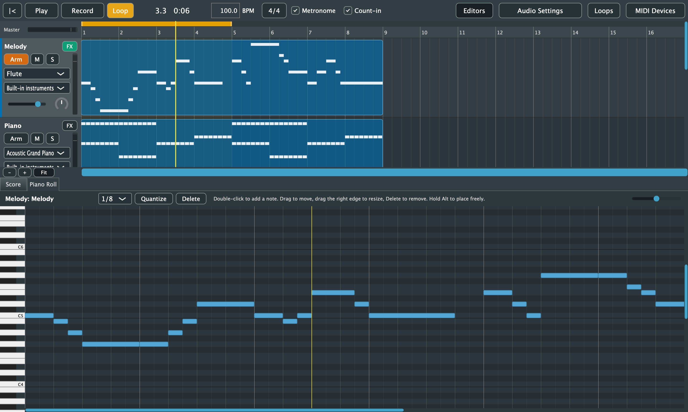

# 7. Piano Roll

[← Recording](06-recording.md) · [Contents](README.md) · [Next: Sheet Music →](08-score.md)

The Piano Roll edits the notes of one MIDI clip. Pitches run up the keyboard on the left, from low to high, with each C labelled (C4 is middle C). Time runs left to right.

## Opening a clip

- Double-click a MIDI clip in the arrangement, or right-click it and choose **Edit Notes**. This opens the **Piano Roll** tab, showing the editors if they were hidden.
- Clicking the **Piano Roll** tab without choosing a clip shows the first clip on the selected track.

The title shows the track and clip, e.g. *Melody: Melody*. It says *No clip yet* when there's nothing to edit.

## Editing notes

| To | Do this |
|---|---|
| Hear a pitch | Click a key on the keyboard |
| Add a note | Double-click an empty spot. It starts on the grid at velocity 100, as long as the last note you resized, or one grid step |
| Select notes | Click a note. Drag across empty space to select several; hold **Shift** to add to the selection, or Shift-click a note to toggle it |
| Select all | **Cmd+A** |
| Move notes | Drag them in time or pitch. All the selected notes move together, and you hear the new pitch |
| Change a note's length | Drag its right edge |
| Place freely | Hold **Alt** while dragging to ignore the grid |
| Delete notes | **Delete** or **Backspace**, or the **Delete** button |

Selected notes are orange and the rest are blue. Brighter notes are louder (higher velocity). Parts outside the clip's playing range are dimmed.

Every edit is one undo step. Keyboard shortcuts work in the Piano Roll once you've clicked in its grid; until then, Delete deletes the selected clip in the arrangement.

## Grid and quantize

- The **grid** menu (**1/4**, **1/8**, **1/16**, **1/32**) sets where notes snap when you add, move or resize them.
- **Quantize** snaps the selected notes, or every note if none is selected, to the grid. Each note's start and end snap, and every note keeps at least one grid step.

## Zoom

The slider at the right of the toolbar zooms the Piano Roll in and out. Scroll to move through time and pitch.

Velocity can't be edited yet, other than by deleting and re-adding notes.
