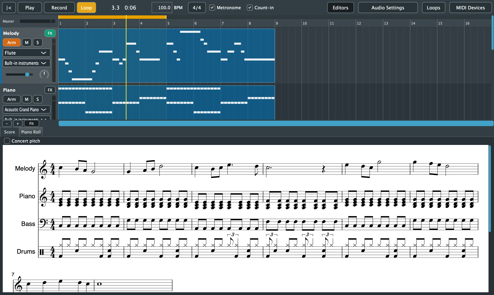

# 8. Sheet Music

[← Piano Roll](07-piano-roll.md) · [Contents](README.md) · [Next: Loops and Accompaniment →](09-loops-and-accompaniment.md)

The **Score** tab shows the whole song as sheet music, one part per track that has notes. It updates as you edit, record or add loops. While recording, it waits until you stop. When a song has no notes yet, it says *Record something to see it as sheet music.*

## How notes become notation

Played music is rarely exactly on the beat, so the score tidies it for reading. **What you hear never changes; only how it's written.**

**Timing:**
- Note timing is snapped to eighth notes, or to sixteenths when the music has many off-beat sixteenths.
- Triplets and swing are detected beat by beat and written as triplets.
- Notes are split at bar lines with ties, and beamed by beat.

**Pitch and staves:**
- The key is the song's key from an imported MIDI file, or estimated from the notes. Accidentals are spelled for that key.
- Each part gets one staff, or a grand staff (treble and bass, split at middle C) when its notes spread too far for one.

**Drums:**
- Drum tracks (Standard Drum Kit) are written on a percussion staff.
- Kick, snare, toms, hi-hats and cymbals each have their usual place and notehead.

## Following playback

While the song plays, the notes being played turn blue and the score scrolls to keep them in view.

## Transposing instruments

Some instruments are written at a different pitch from how they sound. The score writes them as their players read them, based on the track's built-in instrument:
- **Saxophones:** tenor is a ninth up, alto in E♭, baritone an octave and a sixth up.
- **Brass and woodwinds:** trumpet, clarinet and soprano sax are in B♭; horn and English horn in F.
- **Bass and guitar** are written an octave up.
- **Piccolo, celesta, xylophone and glockenspiel** are written lower.

To see everything as it sounds, tick **Concert pitch** above the score. Exports follow the same setting.

Tracks played on an external keyboard's sounds are written as they sound.

## Exporting the score

All of these are in the **File** menu. After an export, Purrlude shows the file in Finder or Explorer.

| Command | Shortcut | Writes |
|---|---|---|
| Export Score as PDF... | Cmd+E | The full score as an A4 PDF, with the song's name as a header |
| Export Parts as PDF... | | One PDF per track with notes, named *Song - Track.pdf*, into a folder you choose |
| Export MusicXML... | | A `.musicxml` file of the full score, for MuseScore, Sibelius, Finale, Dorico and other notation programs |

**Formats:**
- PDFs are vector, so they print sharply at any size.
- MusicXML keeps transpositions, so other programs play transposing parts at the right pitch.

## Not written yet

These aren't handled yet:
- two voices on one staff
- tempo or time signature changes within a song
- tuplets other than triplets within a beat
- chord symbols
- the metronome mark in the on-screen score
