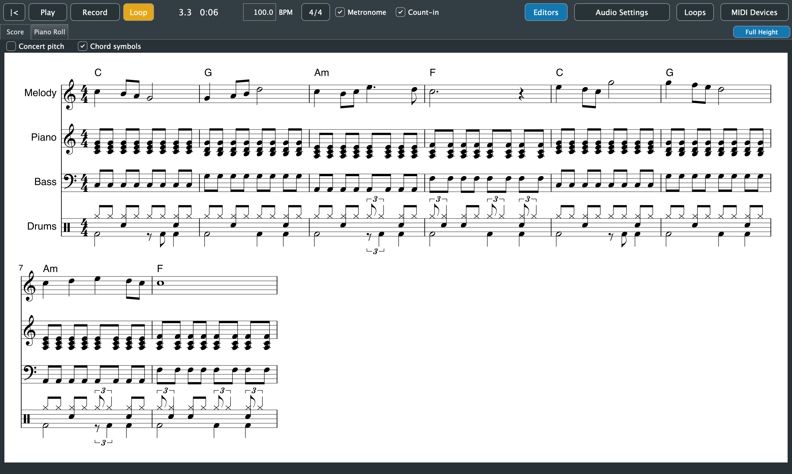

# 8. Sheet Music

[← Piano Roll](07-piano-roll.md) · [Contents](README.md) · [Next: Loops and Accompaniment →](09-loops-and-accompaniment.md)

The **Score** tab shows the whole song as sheet music, one part per track that has notes. It updates as you edit, record or add loops. While recording, it waits until you stop. When a song has no notes yet, it says *Record something to see it as sheet music.*

## Full height

To read or play from the score, click **Full Height** at the right end of the Score and Piano Roll tabs, or press **Cmd+Shift+F**. The arrangement is hidden and the score fills the window below the toolbar. Click it again, or press Cmd+Shift+F, to bring the arrangement back. It works the same for the Piano Roll.

## How notes become notation

Played music is rarely exactly on the beat, so the score tidies it for reading. **What you hear never changes; only how it's written.**

**Timing:**
- Note timing is snapped to eighth notes, or to sixteenths when the music has many off-beat sixteenths.
- Triplets and swing are detected beat by beat and written as triplets.
- Notes are split at bar lines with ties, and beamed by beat.

**Pitch and staves:**
- The key is the song's key from an imported MIDI file, or estimated from the notes. Accidentals are spelled for that key.
- Each part gets one staff, or a grand staff (treble and bass, split at middle C) when its notes spread too far for one.

**Drums:**
- Drum tracks (Standard Drum Kit) are written on a percussion staff.
- Kick, snare, toms, hi-hats and cymbals each have their usual place and notehead.
- As drum parts usually are, they're written in two voices: the hands (snare, hi-hats, cymbals, toms) with stems up, the feet (kick, pedal hi-hat) with stems down.

**Two voices on a staff:** where two lines overlap on one staff, such as a note held under a moving tune, they're written as two voices: the upper with stems up, the lower with stems down, each with its own rhythm. The held note keeps its full length instead of being cut short. Notes that just run into the next one, as in legato playing, stay in one voice.

## Chord symbols

The score shows chord symbols (C, Am7, G/B, Bbmaj7...) above the top part, worked out from the notes of every pitched track.
- **How:** each half bar (a whole bar in 3/4) is heard as a whole, and the chord its notes outline is named, from major, minor, 7, maj7, m7, 6, m6, dim, m7b5, dim7, aug, sus2 and sus4. When the lowest note is another chord tone, it's written as a slash chord: C/E.
- **Where:** a symbol is written only where the chord changes. A single line on its own gets none.
- **Spelling:** roots are named for the song's key, so the flat seventh in C is Bb, not A#.
- **Transposing instruments:** if the top part is one (like a tenor sax), the symbols are written for it, as its player reads them, unless **Concert pitch** is on.
- **Turning them off:** untick **Chord symbols** above the score. Exports always include them.

They're a reading of the notes, not part of the song: they never change what you hear. Busy or unusual harmony can be named in a way a musician wouldn't, especially passing chords.

## Following playback

While the song plays, the notes being played turn blue and the score scrolls to keep them in view.

## Transposing instruments

Some instruments are written at a different pitch from how they sound. The score writes them as their players read them, based on the track's built-in instrument:
- **Saxophones:** tenor is a ninth up, alto in E♭, baritone an octave and a sixth up.
- **Brass and woodwinds:** trumpet, clarinet and soprano sax are in B♭; horn and English horn in F.
- **Bass and guitar** are written an octave up.
- **Piccolo, celesta, xylophone and glockenspiel** are written lower.

To see everything as it sounds, tick **Concert pitch** above the score. Exports follow the same setting.

Tracks played on an external keyboard's sounds are written as they sound.

## Exporting the score

All of these are in the **File** menu. After an export, Purrlude shows the file in Finder or Explorer.

| Command | Shortcut | Writes |
|---|---|---|
| Export Score as PDF... | Cmd+E | The full score as an A4 PDF, with the song's name as a header |
| Export Parts as PDF... | | One PDF per track with notes, named *Song - Track.pdf*, into a folder you choose |
| Export MusicXML... | | A `.musicxml` file of the full score, for MuseScore, Sibelius, Finale, Dorico and other notation programs |

**Formats:**
- PDFs are vector, so they print sharply at any size.
- MusicXML keeps transpositions, so other programs play transposing parts at the right pitch.

## Not written yet

These aren't handled yet:
- more than two voices on one staff
- time signature changes that change the beat unit (other time signature changes are written, and tempo changes are written as tempo marks; gradual ones as *accel.* or *rit.*)
- tuplets other than triplets within a beat
- the metronome mark in the on-screen score
