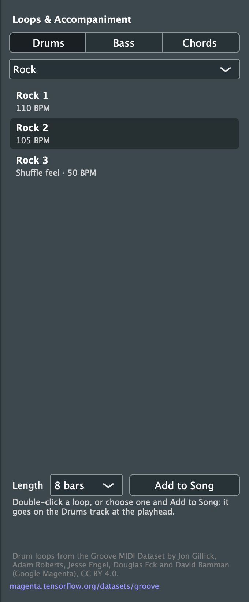
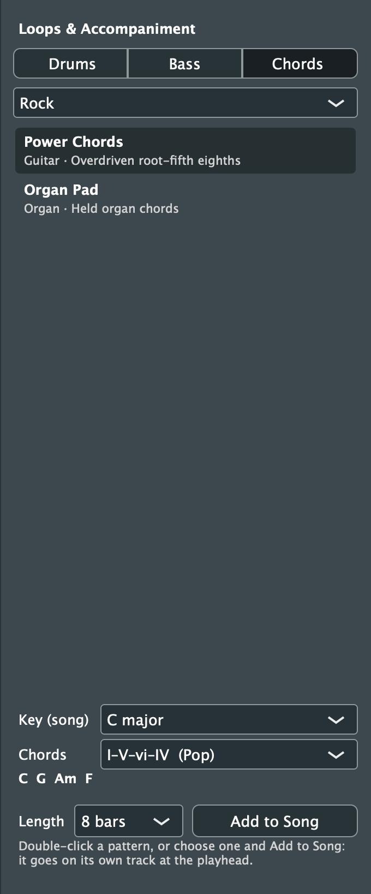

# 9. Loops and Accompaniment

[← Sheet Music](08-score.md) · [Contents](README.md) · [Next: Effects and Reverb →](10-effects.md)

Click **Loops** in the toolbar to open the **Loops & Accompaniment** panel. It adds a drum part, a bass line or a chord part to your song, at the playhead's bar. Everything it adds is ordinary MIDI: it plays with the built-in instruments, follows the tempo, shows in the score and can be edited in the Piano Roll.

The buttons at the top choose what to add: **Drums**, **Bass** or **Chords**.

## Drum loops

1. Click **Drums** and choose a style:
   - Rock, Pop, Funk, Soul, Hip-Hop, Jazz, Latin, Reggae
   - Afrobeat, Disco & Dance, Country, Blues & Shuffle, Punk, New Orleans
2. Choose a loop. Each shows the tempo it was played at, and *Shuffle feel* for loops with a triplet swing.
3. Choose a **Length**: 4, 8, 16 or 32 bars.
4. Double-click the loop, or click **Add to Song**.

**Where it goes:** onto the **Drums** track, which is created if needed, as one clip that repeats the loop. Lengthen the clip to repeat it more.

**Tempo:** the first loop added to an empty song sets the song's tempo to the loop's.

**Where the loops come from:** they're real drummers' performances from the Groove MIDI Dataset, by Jon Gillick, Adam Roberts, Jesse Engel, Douglas Eck and David Bamman (Google Magenta), used under CC BY 4.0. The credit is shown at the bottom of the panel.

 

## Bass lines and chords

1. Click **Bass** or **Chords** and choose a style:
   - Pop, Rock, Ballad, Funk, Jazz
   - Latin, Reggae, Country, Blues
2. Choose a pattern. Each names its instrument and how it plays, e.g. *Bass · Steady eighth notes on the root*.
3. Check the **Key**.
   - It shows **Key (song)** while it's following the song. That's the key from an imported MIDI file, or one estimated from what you've played.
   - Choose any major or minor key to set it yourself.
4. Choose the **Chords**: a chord progression such as *I–V–vi–IV (Pop)*, written for major or minor keys to match. The chords it makes in your key are shown below, e.g. **C G Am F**.
5. Choose a **Length**: one, two or four times through the progression.
6. Double-click the pattern, or click **Add to Song**.

**Where it goes:** each part goes on its own track, named after its instrument (Bass, Piano, Guitar, Organ, Strings, ...) and created if needed.

**How the parts are played:**
- Bass lines stay in the bass's low range.
- Chord parts move smoothly from one chord to the next, as a player would.

Use the same key and progression for bass and chords so they fit together. The patterns are written in 4/4.

 

After adding, the panel says where the part went, e.g. *Added Rock 1 at bar 1*. **Cmd+Z** takes it back out.
