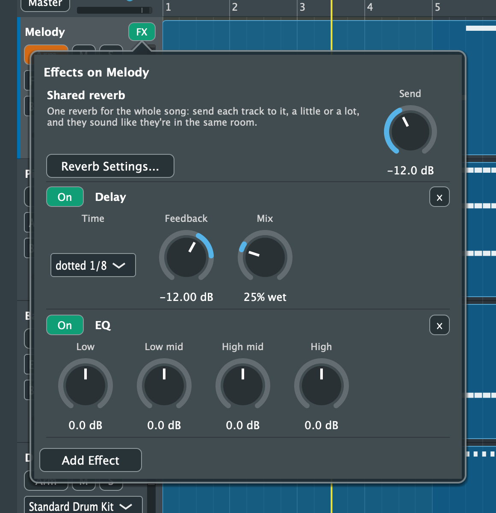
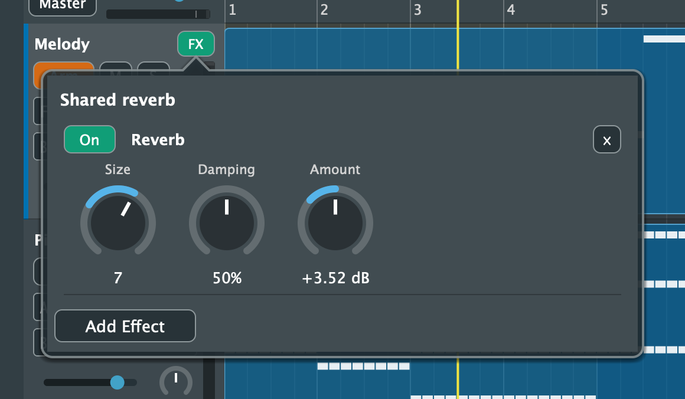
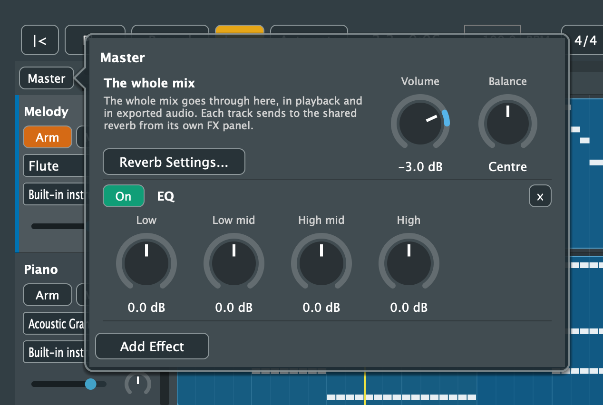
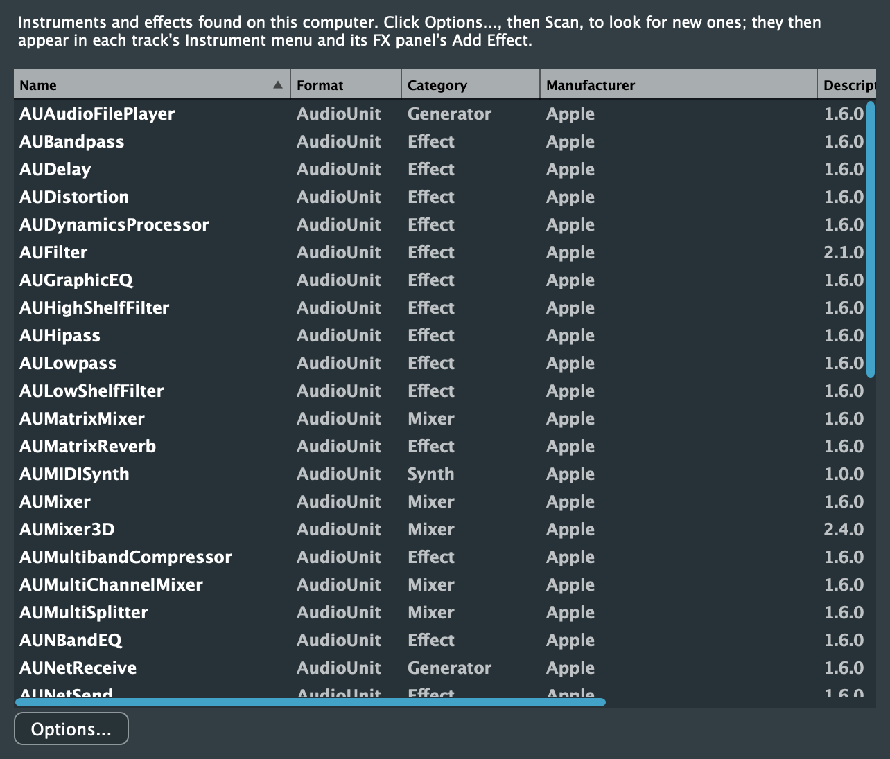

# 10. Effects, Reverb and Plugins

[← Loops and Accompaniment](09-loops-and-accompaniment.md) · [Contents](README.md) · [Next: Audio to MIDI →](11-audio-to-midi.md)

Click a track's **FX** button to open its effects. The panel shows:
- a send to the song's **shared reverb**
- the track's own effects, in the order the sound passes through them

Click anywhere outside the panel to close it. **FX** is lit green when the track has effects or a reverb send.

Effects work on Purrlude's built-in sounds, plugin instruments and audio. When a track plays an external keyboard's sounds, its **FX** button is disabled.

## Adding effects

Click **Add Effect** and choose one of the four below, or a plugin (see Plugins, below). Each built-in effect starts with useful settings.

| Effect | What it's for | Controls |
|---|---|---|
| **Reverb** | Space and room sound | Size, Damping, Amount |
| **Delay** | Echoes in time with the song | Time (1/4, dotted 1/8, 1/8, 1/16), Feedback, Mix |
| **EQ** | Shaping the tone: four bands at 150 Hz, 500 Hz, 2.5 kHz and 8 kHz | Low, Low mid, High mid, High (dB) |
| **Compressor** | Evening out the level | Threshold, Ratio, Makeup |

**Each effect's row:**
- **On** / **Off** switches the effect without losing its settings.
- **×** removes it.
- **Knobs:** drag up and down or round. Double-click one to reset it.

**Effect details:**
- The delay's time is a note value, so the echoes stay in time if you change the tempo.
- Effects come before the track's volume fader, so the fader and meter show the final level.

Adding, removing and switching an effect are each one undo step, and so is each knob drag.

## The shared reverb

A song has one shared reverb that every track can send to. Tracks sent to it sound like they're in the same room. It's usually better than a separate reverb on each track.

- **Send:** turn the **Send** knob in a track's FX panel up from *Off*. Double-click it to set it back to Off.
- **Volume:** the send comes after the track's volume, so turning the track down turns its reverb down too.
- **Solo:** a soloed track keeps its reverb.

**Reverb Settings...** (in a track's FX panel or the master's) opens the shared reverb itself. Size, Damping and Amount apply to every track's reverb. You can add effects there too; they're applied to the reverb sound only (for example an EQ to darken it).

When exporting stems, each stem includes its own share of the reverb, so the stems still add up to the mix.

## The master

Everything you hear goes through the master, in playback and in exported audio. Its strip is at the left end of the ruler, above the track headers: drag the slider for the master volume, or click **Master** for the rest.

The **Master** panel has:
- **Volume:** the level of the whole mix (the same as the strip's slider). A new song starts at −3 dB, which leaves some room before the mix clips. Double-click for 0 dB.
- **Balance:** moves the whole mix to the left or right. Double-click to centre it.
- **Reverb Settings...:** the shared reverb's settings, for every track.
- **Effects on the whole mix:** click **Add Effect** for the same effects and plugins as a track. An EQ shapes the mix's tone; a compressor evens out its level and makes it sound fuller.

**Details:**
- **The order:** master effects come after every track and the shared reverb, and before the master volume, so the meter shows the final level.
- **Undo and saving:** master changes are saved with the song, and each is one undo step, like a track's.
- **MIDI learn:** the master's volume, balance and effect controls can be [learnt from a MIDI controller](13-devices.md#midi-learn).
- **Stems:** exported stems go through the master too.
- **Not yet:** the master can't be automated, since it has no lane in the arrangement.

## Plugins

Purrlude can load third-party instruments and effects in the **VST3** and **Audio Unit** (macOS) formats, and **LV2**.

**Finding them:**
1. Click **Plugins** in the toolbar.
2. Click **Options...** and choose a scan, e.g. **Scan for new or updated VST3 plugins**. Audio Units are found where macOS keeps them; for VST3 and LV2 you can change the folders it looks in.
3. The plugins found are listed, and saved for next time. Scan again after installing new ones.

Plugins are scanned in a separate process, so a plugin that crashes while it's being checked doesn't take Purrlude down. **Options...** can also remove plugins from the list.

**Instruments:** choose one under **Plugins** in a track's [instrument menu](04-tracks.md#the-instrument-track-header). It replaces the built-in instrument, and its window opens. Choosing a General MIDI sound again goes back to the built-in instrument.

**Effects:** choose one under **Plugins** in **Add Effect**. Its row has **On**/**Off** and **×** like the built-in effects, and **Open Window** for its controls.

**Plugin windows** show the plugin's own controls. Changes there are saved with the song. Adding or removing a plugin is one undo step.

**A song opened on a computer without one of its plugins** keeps it: the track's instrument menu says *(not found)*, and an effect's row says it isn't on this computer. Install the plugin and open the song again, or choose another instrument or remove the effect.

Any plugin control can be [automated](04-tracks.md#automation): right-click the track's header and open **Automation**, where each plugin has a submenu.
