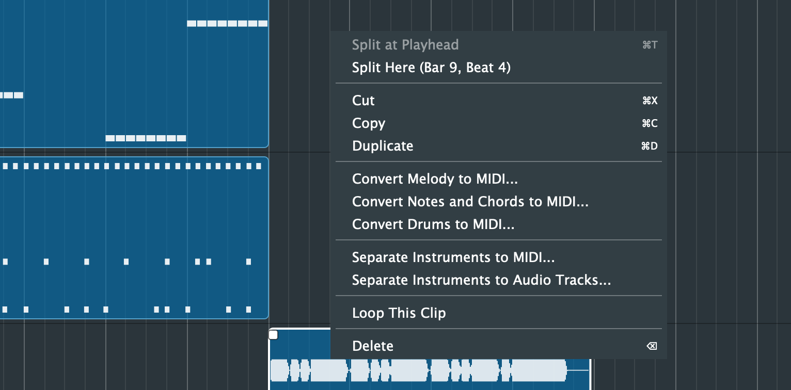
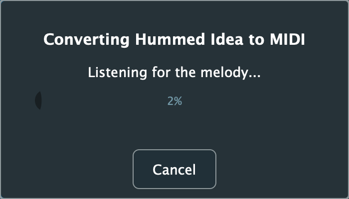
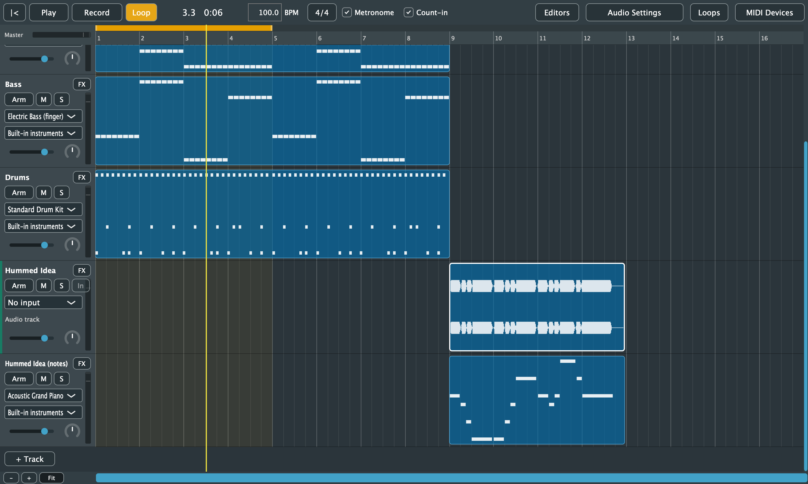

# 11. Audio to MIDI

[← Effects, Reverb and Plugins](10-effects.md) · [Contents](README.md) · [Next: Importing and Exporting →](12-import-export.md)

Purrlude can listen to an audio clip and write down its notes as MIDI. You can then edit them in the Piano Roll and see them as sheet music. It can also split a recorded song into its instruments.

Everything runs on your computer. No audio is sent anywhere.

Right-click an audio clip and choose a command. A progress window shows while it works, and **Cancel** (or Esc) stops it. Only one conversion runs at a time.

## Converting to MIDI

| Command | For | Result |
|---|---|---|
| **Convert Melody to MIDI...** | One note at a time: singing, humming, whistling, a solo instrument | A piano track |
| **Convert Notes and Chords to MIDI...** | Piano, guitar, or several instruments playing together | A piano track |
| **Convert Drums to MIDI...** | A drum recording or loop | A drum-kit track with kick, snare and hi-hat |

**The result:**
- The notes go on a new track under the audio track, named after the clip with *(notes)*, or *(drums)* for drums.
- They line up with the clip's place in the song.
- The whole conversion is one undo step.

**Change the sound:** use the new track's instrument menu, e.g. to Flute for a hummed melody or Acoustic Bass for a bass line.

 

### Tips for good results

- **Melody** follows slides and vibrato as one note, and starts a new note when the pitch settles somewhere new or you re-attack. Very short blips (under 60 ms) are left out. A clean, dry recording works best.
- **Notes and Chords** uses Spotify's basic-pitch model. Occasionally it adds a note an octave above a note with a strong overtone.
- **Drums** finds kicks, snares and closed hi-hats. Toms and cymbals come out as whichever of the three they sound most like. Soft ghost notes may be missed.
- **Expect to tidy up.** No converter is perfect. Use the [Piano Roll](07-piano-roll.md) to fix wrong or missing notes.

**Availability:** Notes and Chords and instrument separation need ONNX Runtime, which is included for Windows, Linux and Apple Silicon Macs. On Intel Macs those commands are greyed out.

## Separating instruments

**Separate Instruments to MIDI...** and **Separate Instruments to Audio Tracks...** split a mixed recording into up to six parts:
- drums
- bass
- vocals
- guitar
- piano
- everything else (strings, synths, horns, ...)

It uses Meta's Demucs model.

- **To Audio Tracks** puts each part on its own audio track under the clip, playing in the same place. Use them to mute, solo or remix parts, or to practise along with one taken out.
- **To MIDI** also converts each part to notes the way that suits it:
  - drums with the drum converter
  - vocals with the melody converter
  - the rest with notes and chords, with the bass kept to its range
  
  Each part goes on its own instrument track with a matching sound.

**What you get:**
- Parts that are almost silent (more than 30 dB quieter than the song) are left out.
- New tracks are named after the clip and the part, e.g. *Song Drums*.
- The whole separation is one undo step.

**Speed:** on a Mac, separating runs on the graphics chip and takes about an eighth of the song's length, e.g. a 3-minute song takes about 25 seconds. The first time is slower (about a quarter of the song's length), while the Mac prepares the model for its graphics chip; it keeps the result (about 430 MB) in `~/Library/Caches/Purrlude` so later separations start at once. If that folder is cleared, the next separation prepares it again. On Windows it runs on the graphics card (any DirectX 12 one, built-in graphics included) when it can: a 2-minute song took about 45 seconds on a laptop with AMD Radeon graphics, and about as long as the song itself without it.

**Limits:**
- Drums usually separate cleanly.
- Pitched instruments can end up in the wrong part, especially synthesised or General MIDI sounds. For example, a saxophone may land in "piano", or a bass in "guitar".
- Separation only knows these six parts.

**The model** is a 115 MB file (`htdemucs_6s.onnx`) that isn't included with Purrlude. The first time you separate instruments, Purrlude asks whether to download it from its GitHub page. Nothing else is sent or received, and your audio stays on your computer. If the download is cancelled or interrupted, the next one carries on from where it stopped, and the file is checked before it's used.

It's kept in your models folder, where you can also put a copy yourself:
- macOS: `~/Library/Application Support/Purrlude/Models/`
- Windows: `%APPDATA%\Purrlude\Models\`
- Linux: `~/.config/Purrlude/Models/`

Developers can make it with `tools/models/export_demucs.py`.
