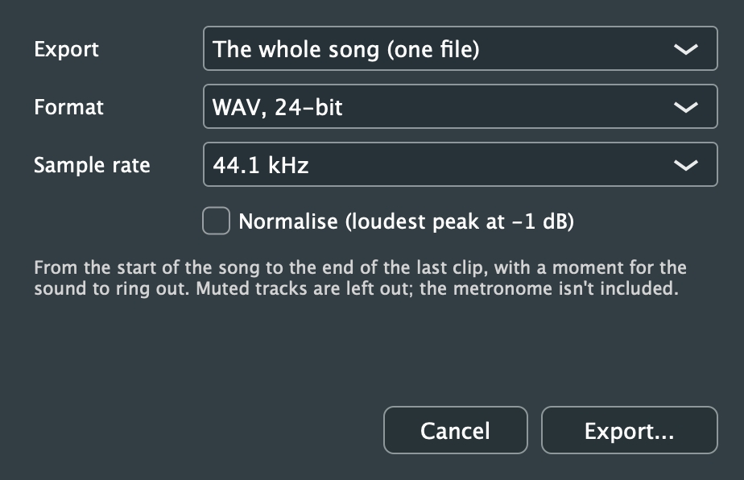

# 12. Importing and Exporting

[← Audio to MIDI](11-audio-to-midi.md) · [Contents](README.md) · [Next: Audio and MIDI Devices →](13-devices.md)

## Importing

| Command | Shortcut | Files |
|---|---|---|
| File > Import MIDI File... | Cmd+I | `.mid`, `.midi`, `.smf`, `.kar` |
| File > Import Audio File... | Cmd+Shift+I | WAV, AIFF, FLAC, Ogg Vorbis, MP3 and other formats your system reads |

You can also **drag files onto the window**, MIDI and audio together. Each import goes in at the playhead's bar and is one undo step.

### MIDI files

**Tracks:**
- Each part of the file becomes an instrument track with one clip, named after the file's track name or its instrument.
- Each part gets the General MIDI sound the file asks for. Channel 10 becomes the drum kit, and so does any other channel the file sets to a drum kit (as Yamaha XG and General MIDI 2 files can). XG's and GS's extra sound variations play as the nearest General MIDI sound.

**What comes in:** notes, controllers, pitch bend and aftertouch.

**Into an empty song,** the file also sets:
- the tempo, with its changes through the song
- the time signature, with its changes (only those that keep the beat unit: a 4/4 file's bars of 3/4, not 6/8)
- the key, which the score and accompaniment then use

For the key, only the first is used. Files timed in SMPTE frames can't be imported.

### Audio files

**Where they go:**
- Each file goes on a new audio track.
- The file is copied into the project's audio folder, so the project keeps working if the original is moved or deleted.

**What you can do next:** convert it to MIDI or separate its instruments; see [Audio to MIDI](11-audio-to-midi.md).

## Exporting audio

**File > Export Audio...** (Cmd+Shift+E) renders the song.

| Option | Choices |
|---|---|
| **Export** | *The whole song (one file)*, or *Stems (one file per track)* |
| **Format** | WAV 24-bit or 16-bit (CD), FLAC 24-bit or 16-bit (lossless, smaller), or Ogg Vorbis (compressed, about 192 kbps) |
| **Sample rate** | 44.1 kHz or 48 kHz |
| **Normalise** | Raises or lowers the whole file so its loudest peak is at −1 dB |

 

**What's included:**
- The export runs from the start of the song to the end of the last clip, plus a moment for reverb and echoes to ring out.
- Muted tracks are left out, and the metronome is never included.
- **Stems** are written one per track with clips, into a folder you choose, each with its share of the [shared reverb](10-effects.md#the-shared-reverb).

**While it renders:**
- A progress window shows; **Cancel** stops it.
- When it's done, the file is shown in Finder or Explorer.
- The dialog remembers your choices for next time.

MP3 export isn't available: Ogg Vorbis is the compressed format.

## Exporting sheet music

**Export Score as PDF...**, **Export Parts as PDF...** and **Export MusicXML...** are covered in [Sheet Music](08-score.md#exporting-the-score).
