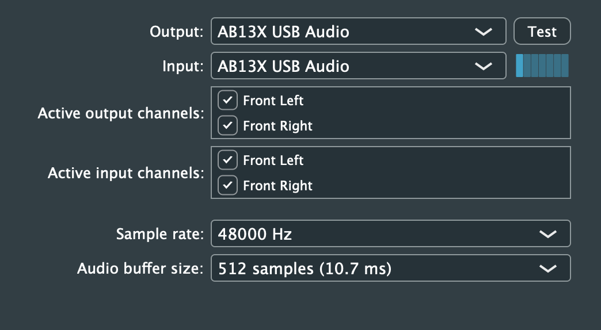
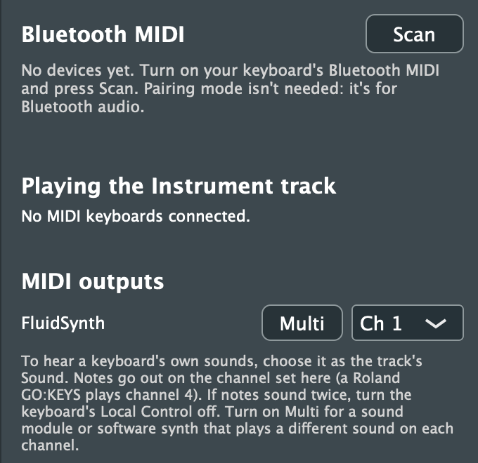
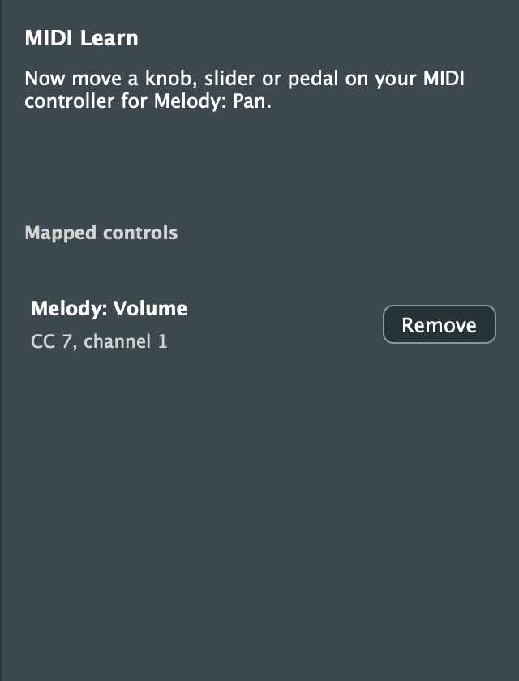

# 13. Audio and MIDI Devices

[← Importing and Exporting](12-import-export.md) · [Contents](README.md) · [Next: Keyboard Shortcuts →](14-shortcuts.md)

## Audio settings



Click **Audio** in the toolbar to choose:
- **Output** and **Input:** the device you listen through and record from. This can be your computer's built-in speakers and microphone, headphones, or an audio interface. **Test** plays a tone, and the meter beside the input shows its level.
- **Active output and input channels:** which channels of a multi-channel interface are used. The active inputs are what audio tracks can [record from](06-recording.md#recording-audio).
- **Sample rate** and **Audio buffer size:** a smaller buffer means less delay between playing and hearing, but more risk of clicks on a busy computer.

Purrlude remembers these settings. Close the window with Esc or its close button.

### Built-in instrument sounds

Purrlude's built-in instruments play GeneralUser GS, a SoundFont that comes with it. At the bottom of the Audio window, **Choose SoundFont...** plays another SoundFont (`.sf2`) instead, for every track and song: for example one with the variations of Yamaha XG or General MIDI 2 sounds. **Use Built-in** goes back to GeneralUser GS.
- Songs keep each track's sound by number, so they play with whichever SoundFont is chosen. A variation the SoundFont hasn't got plays the General MIDI sound.
- If the SoundFont can't be read or isn't one Purrlude can play, the built-in sounds play and the window says why.
- Only `.sf2` files work; compressed `.sf3` ones don't.
- A SoundFont you choose isn't part of Purrlude: check its licence before sharing music made with it.

### A track's own SoundFont

A track can play a SoundFont of its own while the others play the app's, for example a piano SoundFont on the piano track only. In the track's **sound menu** (under the instrument menu):
- **Choose a SoundFont...** picks a `.sf2` file for this track. SoundFonts you've used lately are listed above it, by name, to pick again in one click.
- The **instrument menu** then lists that SoundFont's own sounds by name, grouped by bank, with its drum kits under **Drum kits**.
- **Built-in instruments** goes back to the app's SoundFont.

**Good to know:**
- A SoundFont used by several tracks is loaded once. A big one takes a few seconds to load; until then the track plays the app's sounds, and the menu shows *(loading...)*.
- The song remembers where the file is but doesn't copy it. On another computer, or if the file moves, the track plays the app's sounds and its sound menu shows the SoundFont as *(missing)*. Choose it again from there.
- Earlier versions of Purrlude open such a song with a warning, and play the app's SoundFont on that track.

## MIDI keyboards



Click **MIDI Devices** in the toolbar for the devices panel.

**Connecting a keyboard:**
- **USB and other wired keyboards** work as soon as they're plugged in.
- Every connected keyboard plays the selected instrument track. They're listed under **Playing the Instrument track**.
- You don't need to set up any routing. To play a different track, click it.

To control Purrlude from your keyboard's knobs and sliders, see MIDI learn below.

<br clear="right">

## MIDI learn



MIDI learn links a knob, slider or pedal on your MIDI controller to a control in Purrlude, so you can turn it by hand.

1. Click **MIDI Learn** in the toolbar. While its panel is open, Purrlude is learning.
2. Move a control in Purrlude:
   - a track's volume or pan
   - the master's volume or balance
   - an effect's knob (a track's or the master's), or the reverb send
   - a control in a plugin's window
3. Move a knob, slider or pedal on your controller. The panel says what it now controls.
4. Repeat for more controls, then close the panel.

**How it works:**
- **Your song keeps them:** the links are saved with it.
- **One each:** a controller controls one thing, and a control has one controller. Learning one again moves it.
- **While the panel is open,** controllers don't move their controls, so you can learn without changing anything.
- **Removing:** each link has **Remove** in the panel. Learning and removing can be undone.
- **Recording:** with **Automate** on, controller moves during playback are [recorded as automation](04-tracks.md#recording-automation).
- **Not learnable:** Bank Select (used to pick a keyboard's tones), data entry and channel mode messages. Notes and the pitch wheel can't be learned either.
- **Undo:** moving a controller can be undone like moving the control on screen.

<br clear="right">

## Bluetooth MIDI

Purrlude connects to Bluetooth LE MIDI keyboards and controllers directly, on macOS 13 or later and on Windows. On Linux it can't scan for them yet: connect the device in the system's Bluetooth settings, and with BlueZ's MIDI support it appears as an ordinary MIDI port.

1. Turn on your keyboard's Bluetooth MIDI. Its "pairing mode" isn't needed: that's for Bluetooth audio.
2. In the **Bluetooth MIDI** section, click **Scan**. Nearby devices appear with their signal strength.
3. Click **Connect**.

Once connected, the keyboard plays like a wired one.

**Remembered devices:**
- Purrlude remembers the devices you've connected and reconnects them at launch.
- If a connection drops, it reconnects when the device comes back.
- Each device shows its state: *Connected*, *Connecting...*, *Reconnecting...*, *Not in range*, or *Not found yet - turn it on to reconnect*.

**Disconnect** drops the connection for now. **Forget** disconnects and stops reconnecting automatically.

On Windows, devices that need a PIN must first be paired in Windows Settings.

**Using a keyboard with more than one computer:** some keyboards (a Roland GO:KEYS, for one) remember only the last computer they paired with. If a connect fails with *the device forgot this Mac*, remove the keyboard in System Settings > Bluetooth (the ⓘ button, then **Forget This Device**) and click **Connect** again. On Windows, remove it under Settings > Bluetooth & devices.

## Playing a keyboard's own sounds

A keyboard with built-in sounds, such as a home keyboard or digital piano, can play a track instead of Purrlude's instruments:

1. In the track header's **sound menu**, choose the keyboard instead of *Built-in instruments*. A keyboard that isn't connected shows as *(not connected)*.
2. In the **instrument menu**, choose one of the keyboard's tones.
   - For keyboards Purrlude knows, such as the Roland GO:KEYS 3 and 5, you get the full tone list.
   - For others, choose a tone on the keyboard itself: Purrlude learns it and adds it under **Learned tones**. Use **Rename this tone...** to name it.
   - **Keyboard's current tone** leaves the keyboard's tone alone.
3. Under **MIDI outputs** in the devices panel, check the **channel** the keyboard plays its own sounds on. Known keyboards are set for you; a Roland GO:KEYS, for example, uses channel 4.

The tone is sent when you choose it, when the keyboard becomes the track's sound, and each time playback starts. Choosing a tone on the keyboard while it plays a track makes that the track's tone.

**If notes sound twice,** turn off **Local Control** on the keyboard. Otherwise it sounds both from its own keys and from what Purrlude sends back.

Purrlude effects and meters don't apply to a keyboard's own sounds. The track's volume and pan are sent to the keyboard instead.

## Sound modules and software synths (multi-part)

A keyboard like the GO:KEYS plays one part: everything sent to it plays with one sound. A **multi-part** (multi-timbral) device plays a different sound on each of its 16 channels. Examples:
- hardware sound modules and many workstations
- the *Microsoft GS Wavetable Synth* built into Windows
- software synths such as [FluidSynth](https://www.fluidsynth.org) on any system

Purrlude can play a whole song through one of these, each track with its own sound:

1. In the devices panel, under **MIDI outputs**, turn on **Multi** for the device. Its channel menu is greyed out, because each track now gets its own channel.
2. Choose the device as the **sound** of each track you want it to play.
   - Each track gets a channel of its own: drum-kit tracks get channel 10, the General MIDI drum channel, and the others take the lowest free channel.
   - Each track keeps its General MIDI sound, so a whole song switches over and sounds the same.
   - The sound menu shows the track's channel, e.g. *FluidSynth · Ch 3*.
3. The **instrument menu** lists the 128 General MIDI sounds and the drum kits, sent to the device as Program Changes. Choosing a drum kit moves the track to channel 10. A General MIDI 2, GS or XG device plays the kit you choose; a plain General MIDI device has only its standard kit.

**Changing a track's channel:** open the track menu (**⋯** on its header, or right-click it) and choose **MIDI Channel**. For example, give two tracks the same channel to have them share a sound.

**Turning Multi off** puts every track on that device back on the device's one channel.

**Limits:**
- Up to 16 tracks can have channels of their own. After that, tracks share the least-used channel.
- All the parts share the device's polyphony (how many notes it can play at once).

### Trying it with FluidSynth on a Mac

FluidSynth is free (`brew install fluid-synth`). Start it with a General MIDI SoundFont, such as GeneralUser GS:

```sh
fluidsynth -a coreaudio -m coremidi -o midi.portname=FluidSynth GeneralUser-GS.sf2
```

It appears in Purrlude's **MIDI outputs** as *FluidSynth*. Turn on **Multi** for it, then choose it as the tracks' sound. To stop it, type `quit` in the terminal or press Ctrl+C.
