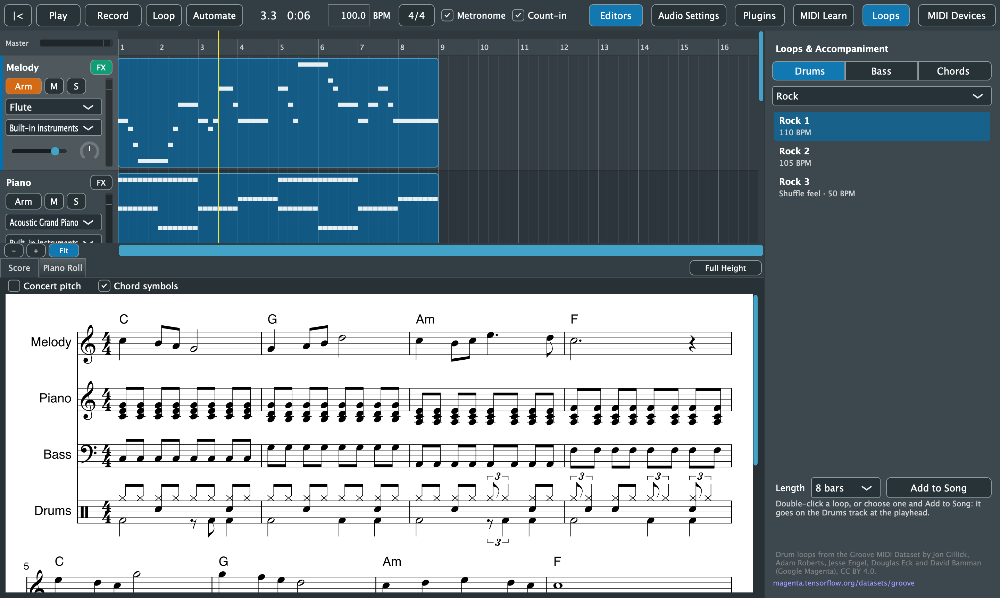

# Purrlude User Guide

Purrlude is a music workstation for writing, recording, arranging and mixing songs, and for seeing them as sheet music. This guide covers what it can do today, one topic per page.

> **Status: beta on macOS, alpha on Windows and Linux.** There are no prebuilt downloads yet: Purrlude is built from source ([README](../../README.md#building)). Project files may still change format before 1.0.

To make a PDF of the whole guide, run `python3 tools/docs/build_user_guide_pdf.py`. It writes `Purrlude User Guide.pdf` here.

## Contents

| | Section | What's in it |
|---|---|---|
| 1 | [Getting Started](01-getting-started.md) | The window, and a first song in a few minutes |
| 2 | [Projects](02-projects.md) | New, open, save, autosave and recovering unsaved work |
| 3 | [Transport, Tempo and Looping](03-transport.md) | Play, record, tempo, time signature, metronome, count-in and loop playback |
| 4 | [Tracks and Mixing](04-tracks.md) | Instrument and audio tracks, sounds, volume, pan, mute and solo |
| 5 | [Arranging Clips](05-arrangement.md) | Moving, copying, resizing and deleting clips, zooming and scrolling |
| 6 | [Recording](06-recording.md) | Recording MIDI and audio, inputs, monitoring, and loop recording with takes |
| 7 | [Piano Roll](07-piano-roll.md) | Adding and editing notes, quantizing |
| 8 | [Sheet Music](08-score.md) | The live score, transposing instruments, and exporting PDF and MusicXML |
| 9 | [Loops and Accompaniment](09-loops-and-accompaniment.md) | Drum loops, bass lines and chord parts in any key |
| 10 | [Effects and Reverb](10-effects.md) | Reverb, delay, EQ, compressor and the shared reverb |
| 11 | [Audio to MIDI](11-audio-to-midi.md) | Turning melodies, chords and drums into notes, and separating a song into instruments |
| 12 | [Importing and Exporting](12-import-export.md) | MIDI and audio files in; audio, stems, PDF and MusicXML out |
| 13 | [Audio and MIDI Devices](13-devices.md) | Audio interfaces, MIDI keyboards, Bluetooth MIDI and playing a keyboard's own sounds |
| 14 | [Keyboard Shortcuts](14-shortcuts.md) | Every shortcut and mouse gesture in one place |

## Conventions

- Shortcuts are written for macOS. On Windows and Linux, use **Ctrl** where this guide says **Cmd**, and **Alt** for **Option**.
- **Right-click** means a right-click, a two-finger click on a trackpad, or Ctrl-click on a Mac.

---

The PDF is built from these pages by `tools/docs/build_user_guide_pdf.py`. The screenshots are taken by the app itself: run `Purrlude --doc-screenshots docs/user-guide/images` from a development build (see `src/app/DocScreenshots.cpp`). It builds the demo song from the built-in loops and accompaniment, so they can be retaken whenever the interface changes.
